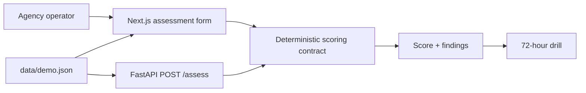

# Architecture

GitHub Pages calculates locally from fictional data. The tested FastAPI service implements the same operation but is not publicly hosted.

`POST /assess` accepts creators (1–500), monthly revenue (0–10M), dependence/archive/contact percentages, readiness booleans, and drill age (0–3650 days). It returns resilience, risk band, exposed revenue, findings, tasks, and rule version. Invalid types/ranges return 422.

Failure paths: invalid inputs → inline error/422; empty fixtures → explicit empty state; calculation exception → visible alert and cleared result; slow action → disabled button; back/navigation → ephemeral demo state. Production adds tenants, Postgres, encrypted evidence, audit logs, queued checks, rate limits, connector telemetry, and an incident runbook.
